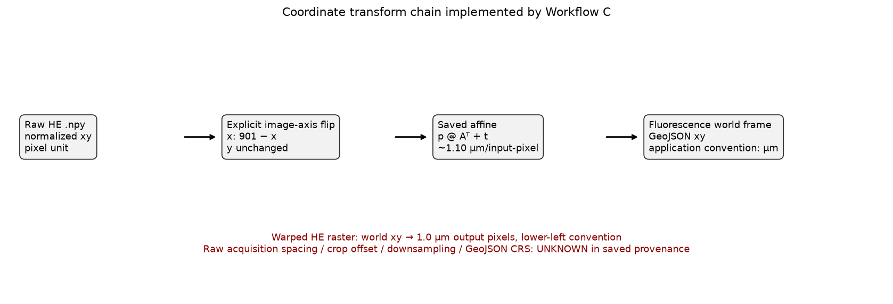

# Coordinate system audit

## Scope and verdict

The saved computation chain is internally reproducible, but acquisition-level metadata are incomplete. Therefore the coordinate system is **UNKNOWN**, not PASS or FAIL: no numerical sign of a duplicated affine, inverse-matrix misuse, or row/column swap was found, while raw HE pixel spacing, crop offset, downsampling history, and the source GeoJSON CRS/unit declaration were not retained.

## Implemented transform chain



1. `load_npy_centers` normalizes the HE input to columns `(centroid_x, centroid_y)` according to the UI's `xy/yx` selection. The normalized saved array has shape (1842, 2); the original selection value itself was not saved.
2. `load_geojson_centroids` reads `(centroid_x, centroid_y)` properties or the arithmetic mean of exterior vertices. It does not read/preserve a CRS, pixel spacing, crop offset, or image bounds.
3. Workflow C tries explicit image-axis flips. This run saved `flip_x=true`, `flip_y=false`, with width/height 901 px.
4. The oriented row vectors are mapped as `world = oriented @ A.T + t`.
5. Candidate discovery uses the saved affine-aligned subset directly in the fixed world frame; no affine is applied a second time.
6. The warped HE raster is an output sampling grid at 1.0 µm/pixel with lower-left world convention. That output spacing is not evidence of the raw HE acquisition spacing.

Saved post-flip matrix:

```text
[[-1.0964392   0.01346399]
 [-0.0081116  -1.10035744]]
```

Effective raw-pixel matrix after composing the x flip:

```text
[[ 1.0964392   0.01346399]
 [ 0.0081116  -1.10035744]]
```

The effective mapping is approximately `x_world = +1.0964*x_px + 0.0135*y_px + 14.9187` and `y_world = +0.0081*x_px - 1.1004*y_px + 1006.1875`. Thus raw image y (row direction) is reversed into world y. Its determinant is -1.206584; the reflection is expected when converting a y-down image grid into a y-up world display, but the missing source CRS prevents an external orientation proof.

## Numerical checks

| Check | Result |
|---|---:|
| Original HE → saved affine max error | 0.000e+00 µm |
| Affine → inverse → original max error | 1.705e-13 px |
| Post-flip determinant | 1.206584 |
| Effective determinant including flip | -1.206584 |
| Singular scales | 1.101768, 1.095135 µm/input-pixel |
| Polar rotation after explicit flip | -179.4373° |
| Fixed subset exact row mapping | 1,830/1,830 |
| Moving subset exact row mapping | 1,754/1,754 |
| Reconstructed saved subset filter | fixed=True, moving=True |

## Known and unknown metadata

| Item | Audit result |
|---|---|
| Saved registration coordinates | GeoJSON world-xy, application labels unit as µm |
| Raw HE coordinates | normalized x/y in image pixels; source column order selection not preserved |
| Axis reversal | saved x flip, followed by near-180° post-flip affine; effective raw mapping reverses y |
| Warped HE pixel spacing | 1.0 µm/pixel (output grid only) |
| Raw HE x/y pixel spacing | **UNKNOWN** |
| Raw image origin | code treats coordinates as image x/y; exact detector convention **UNKNOWN** |
| Raw crop offset | **UNKNOWN** |
| Downsampling factor | **UNKNOWN** |
| GeoJSON CRS/unit metadata | **UNKNOWN**; loader discards collection metadata |
| Independent landmarks/TRE | unavailable; TRE not computed |

The current `point_io.py` and `geojson_utils.py` explicitly contain TODOs to preserve these metadata. This is a provenance gap, not direct evidence that the numerical coordinates are wrong.
